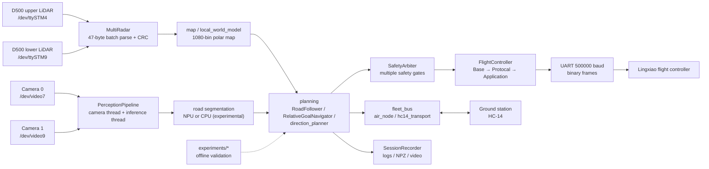

# System Architecture — STM32MP257 UAV Companion Computer

> **Scope**: architecture of the onboard/companion computer stack at `main` =
> `8bd19eb027f0ef1d3ab71a0d24ff4d73105be428` (2026-08-12). Sources: `PROJECT_OVERVIEW.md`,
> `PROJECT_STATUS.md`, `ALGORITHM_REFERENCE.md` and the entry modules in this
> repository. Claims about flight testing are limited to what those documents state.

## 1. Purpose and boundary

The system runs on an MYiR MYD-LD25X board (STM32MP257, Cortex-A35, OpenSTLinux)
and performs **high-level perception, planning and safety arbitration** for a UAV.
It talks to an external Lingxiao (匿名科创) flight controller over a binary UART
protocol — **not MAVLink**. It does not implement the flight controller's inner
control loops.

Two mission families exist:

- `road_follow_main.py` — camera + segmentation-based road following;
- `goal_nav_main.py` — dual D500 LiDAR relative-goal navigation with tube-based
  collision checking.

## 2. Diagram A — system panorama

The NPU path is drawn as **experimental**: see §7 for the documented evidence that
INT8 NPU acceleration was not achieved at the time of writing.

## 3. Diagram B — road-following data path

```mermaid
flowchart LR
    CAM["CameraThread<br/>latest frame"] --> BUF["SharedLatest frame buffer"]
    BUF --> INF["Segmentation thread<br/>NPU/CPU inference"]
    INF --> RES["latest mask + lane offset"]
    RES --> CTL["road follow control loop<br/>~10 Hz"]
    CTL --> CMD["vx + yaw_rate command"]
    CMD --> ARB["SafetyArbiter<br/>stale sensor / fault gates"]
    ARB --> FCP["FlightController Application"]
    FCP --> SER["Serial transport"]
    SER --> FC["Lingxiao FC"]
```

## 4. Component evidence

| Component | Role | Evidence @ `8bd19eb0` | Status |
|---|---|---|---|
| `road_follow_main.py` | Segmentation road-follow entry; builds `PerceptionPipeline` | module docstring + imports | production entry |
| `goal_nav_main.py` | Forward radar-avoidance mission entry | module docstring + imports | production entry |
| `perception_pipeline.py` | Camera thread + inference thread + `SharedLatest` buffers; control loop reads latest result | module docstring | production |
| `autonomy_hardware.py` | Builds dual-radar (`MultiRadar`) and FC connection | `build_dual_radar`, `connect_fc` | production helper |
| `safety_arbiter.py` | Wrapper over `FlightController.Solutions.Safety` | module docstring | production |
| `road_follow_mission.py` | Compatibility wrapper over `RoadFollower` | imports `FlightController.Solutions.RoadFollower` | production |
| `direction_planner.py`, `local_world_model.py` | Direction candidates and local world model | root modules | production |
| `flight_controller/FlightController/*` | FC serial protocol (`Base`, `Protocal`, `Application`), components and solutions | directory | third-party-derived layer (see §7) |
| `fleet_bus/*` | Air node, HC-14 transport, protocol, pose provider, trace buffer | `fleet_bus/` | production link |
| `record_data.py` | Session recording (NPZ / media) | root module | production |
| `experiments/road_contour_bypass`, `experiments/visual_radar_bypass` | Offline experiments and optimization reports | `experiments/` | experimental |
| NPU toolchain docs | `NPU_*.md` — conversion, ST Cloud findings, failure reports | root docs | experimental |

## 5. Runtime model

`PROJECT_STATUS.md` documents the current fused runtime as a **multi-process**
architecture (`ProcessRuntime`, Linux spawn): control + dual-radar processes bound
to CPU0, vision/NPU worker on CPU1, and an independent `SessionRecorder` process at
`nice +10`. Frames and point clouds are passed through shared-memory slots with a
"latest snapshot wins" policy; the control loop never waits for sensors or disk.

## 6. Safety-relevant behaviour found in code/docs

- `SafetyArbiter` is the single gate before commands reach the flight controller.
- Radar CRC errors mark the sensor unhealthy immediately and recover after five
  fresh snapshots without new CRC errors (`PROJECT_STATUS.md`).
- Stale vision or radar input must not be treated as a valid measurement; the
  control loop consumes only the latest snapshot.
- The flight-controller link is a raw binary UART protocol, not MAVLink; mixing the
  two would be a protocol error.

## 7. Validation and limitations

- **NPU acceleration is not established.** `NPU_ST_CLOUD_20260709_FINDINGS.md` states
  that FP32 `.nb` models load but were **not** observed to use `/dev/galcore`, and
  INT8/QDQ conversion did not yet produce a usable `.nb`; `PROJECT_STATUS.md` also
  records an NPU worker RSS growth limitation. Treat NPU results as experimental.
- Model and calibration assets dominate the repository size; they are engineering
  data, not generated cache.
- `FlightController/` is **content-duplicated** from the separate
  `FlightController_stm` repository (21 identical blobs, historical DAG not
  connected). It should not be described as newly written flight-control firmware.
- No root `README.md` exists yet; `PROJECT_OVERVIEW.md` / `PROJECT_STATUS.md` are the
  current narrative sources. There is no root LICENSE.
- No performance numbers are asserted here beyond what the cited documents record;
  the documents themselves note that earlier targets were not achieved.

## 8. Related documents

- `PROJECT_OVERVIEW.md` — system description and hardware topology
- `PROJECT_STATUS.md` — latest runtime/status notes (authoritative over older sections)
- `ALGORITHM_REFERENCE.md` — algorithm-by-algorithm reference with source locations
- `GOAL_NAV_ALGORITHM.md`, `HARDWARE_INTERFACE.md`, `PARAMETER_AUDIT.md`
- `fleet_bus/README.md`
- `NPU_*.md` — model conversion and evaluation records
